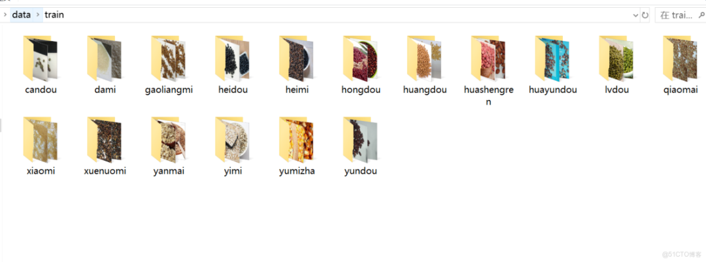
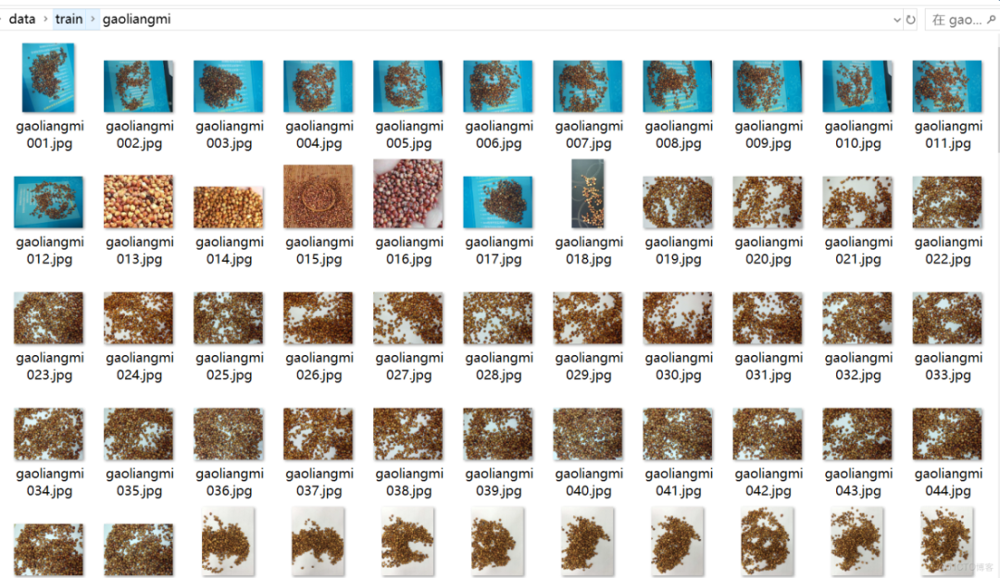
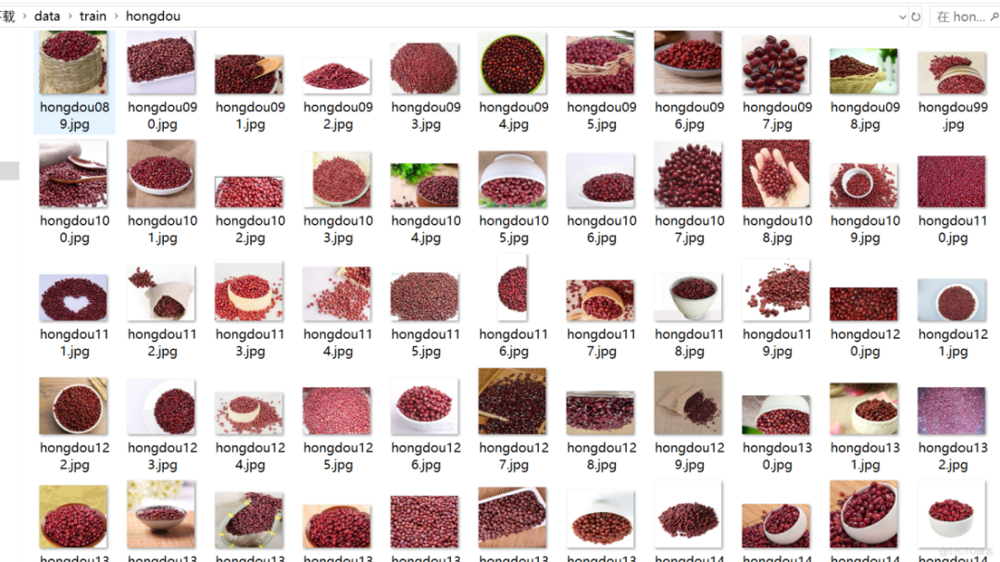
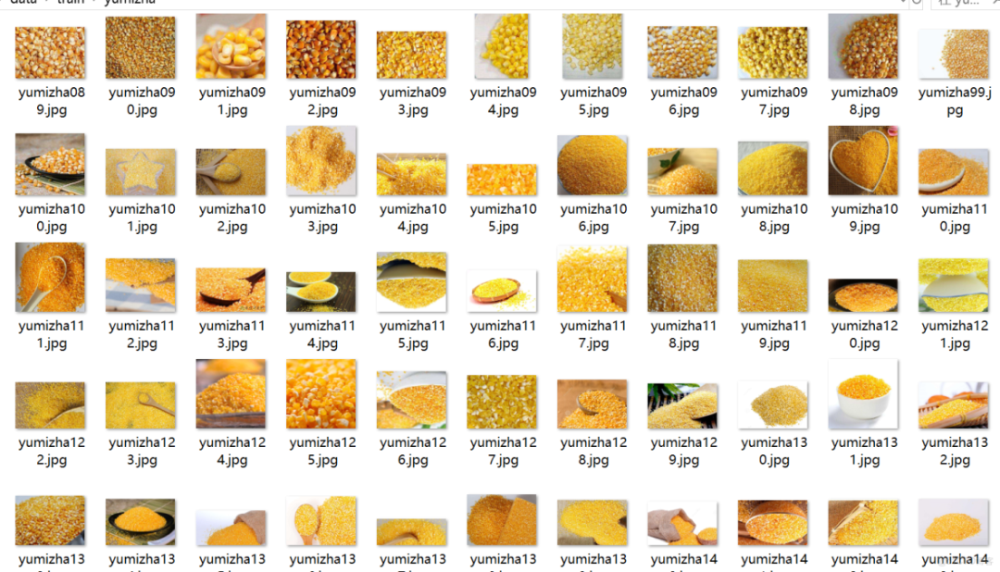
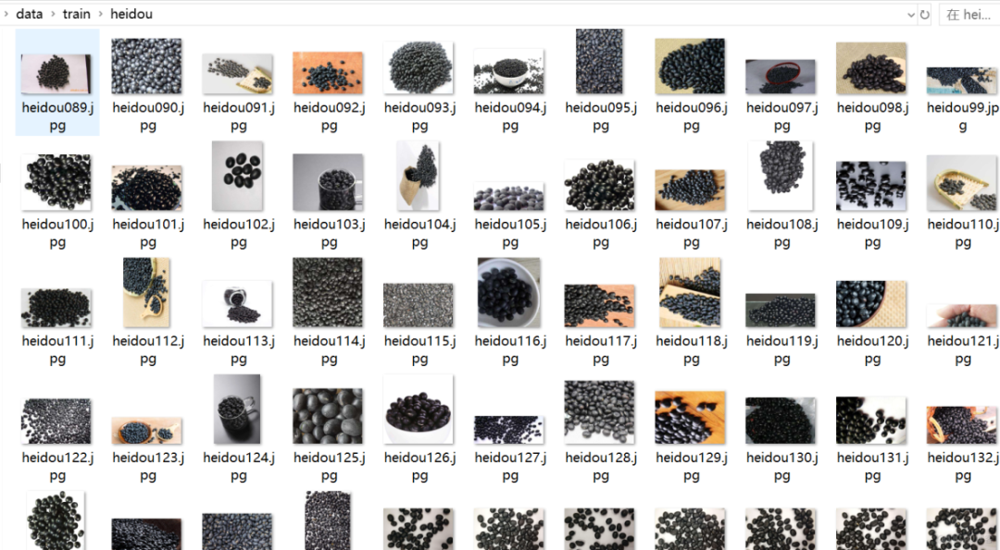

# 16 types of grains and cereals classification dataset 5300 images 17 categories

The classification folder is shown below. Note that this is a classification dataset and cannot be used for object detection; it contains only images without annotations, placed under the corresponding folders with the name of the grain:



Output only - do not answer it, do not write a guide, do not add anything:

```
{
"candou": "broad bean",
"dami": "rice"
"gaoliangmi": "sorghum rice",
"heidou": "black beans"
"heimi": "black rice",
"hongdou": "red beans",
"huangdou": "soybean",
"huashengren": "peanut kernels"
"huayundou": "flowering soybean",
"lvdou": "mung bean",
"qiaomai": "buckwheat",
"xiaomi": "Xiaomi",
"xuenuomi": "Snow glutinous rice",
"yanmai": "oatmeal"
"yimi": "Job's tears",
"yumizha": "corn cobs",
"yundou": "mung bean"
}
```

Image example:










## Payment

Here is a pay link on Stripe ( https://buy.stripe.com/3cs8yP7sY87d0vu9AB ). Please contact me lonlonago@foxmail.com after funding $89, and I will send you a complete data files , thank you!


